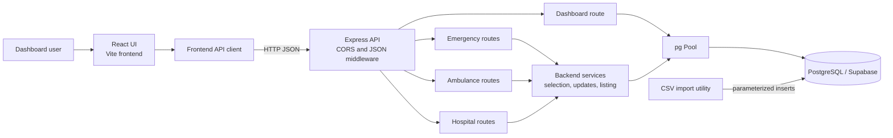
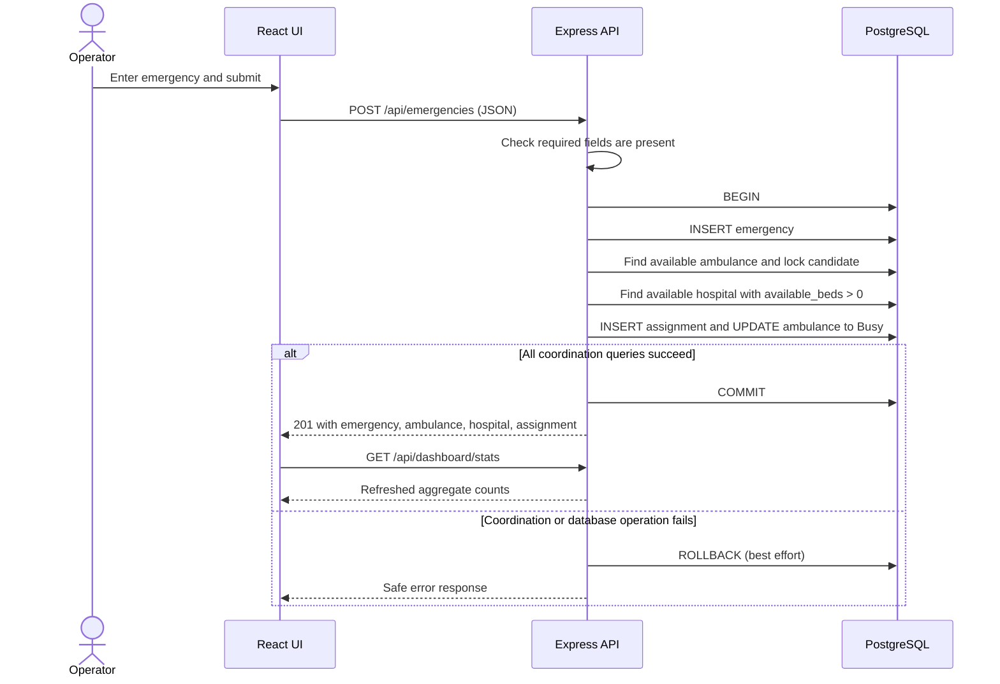
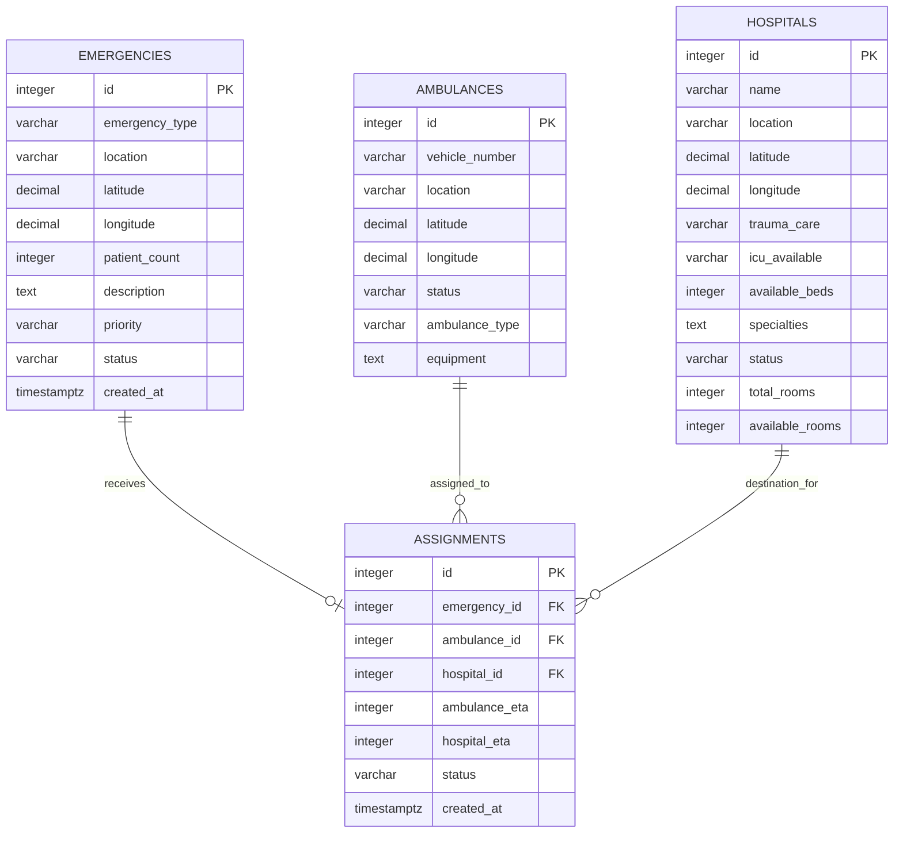
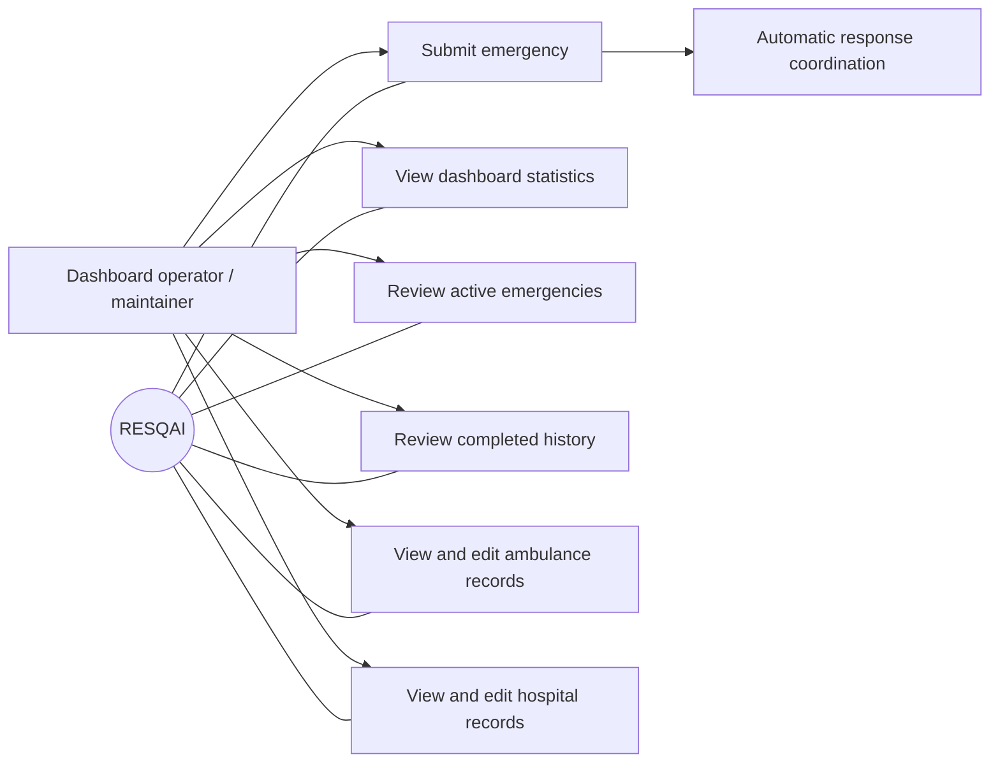

# RESQAI

## Smart Emergency Response Network

### Software Requirements Specification

**Version 1.0**

Prepared 25 October 2026

Baseline of the repository implementation, with proposed targets labeled

Prepared using IEEE 29148 requirements-engineering principles and a conventional IEEE-style SRS structure

---

| Document property | Value |
|---|---|
| Document type | Software Requirements Specification (SRS) |
| Version | 1.0 |
| Preparation date | 25 October 2026 |
| System | RESQAI — Smart Emergency Response Network |
| Status | Baseline of the repository implementation, with proposed targets labeled |
| Standard basis | IEEE 29148 requirements-engineering principles; conventional IEEE-style SRS structure |

> **Operational limitation.** RESQAI is an emergency-coordination and information-management prototype. It is not a replacement for emergency dispatch professionals, emergency medical services, or clinical decision-making. The current UI explicitly identifies the application as a demo without sign-in or staff authorization. It must not be used as the sole means of operating real emergency response.

## Table of Contents

1. [Introduction](#1-introduction)
2. [Overall Description](#2-overall-description)
3. [System Architecture and Interfaces](#3-system-architecture-and-interfaces)
4. [Functional Requirements](#4-functional-requirements)
5. [External Interface Requirements](#5-external-interface-requirements)
6. [Data Requirements and Database Design](#6-data-requirements-and-database-design)
7. [Non-Functional Requirements](#7-non-functional-requirements)
8. [Use Cases and User Workflows](#8-use-cases-and-user-workflows)
9. [Business Rules and Constraints](#9-business-rules-and-constraints)
10. [Error Handling and Exception Scenarios](#10-error-handling-and-exception-scenarios)
11. [Verification and Acceptance Criteria](#11-verification-and-acceptance-criteria)
12. [Limitations and Future Enhancements](#12-limitations-and-future-enhancements)
13. [Appendices](#13-appendices)

---

## 1. Introduction

### 1.1 Purpose

This SRS describes the RESQAI implementation present in this repository as of the preparation date. It records observable requirements, interfaces, data, constraints, and verification evidence derived from the frontend, backend, SQL schema and migrations, sample data, tests, and setup documentation. It distinguishes implemented behavior from partial behavior, unsupported capabilities, and proposed acceptance targets.

### 1.2 Scope

RESQAI provides a browser dashboard for submitting emergencies, attempting to coordinate an ambulance and hospital, viewing emergency records and aggregate counts, and maintaining ambulance and hospital information. The backend persists records in PostgreSQL and exposes JSON HTTP endpoints. Emergency submission inserts an emergency and performs selection, assignment creation, and ambulance status change inside one PostgreSQL transaction.

The current implementation uses predefined Chennai-area location choices in the submission form; it does not obtain live coordinates or track moving vehicles. It is a prototype and does not provide the operational, staffing, privacy, or availability controls required for production dispatch.

### 1.3 Intended Audience

This document is intended for:

- Academic evaluators and project demonstrators.
- Software engineers maintaining or extending RESQAI.
- Test engineers verifying current and future behavior.
- System analysts and project stakeholders reviewing scope and limitations.
- Database operators configuring the PostgreSQL/Supabase environment.

### 1.4 Definitions, Acronyms, and Abbreviations

| Term | Meaning in this document |
|---|---|
| API | Application Programming Interface |
| DBMS | Database Management System |
| ETA | Estimated time of arrival; current implementation calculates an approximate value in minutes from straight-line distance |
| HTTP / HTTPS | Hypertext Transfer Protocol / its encrypted transport form |
| JSON | JavaScript Object Notation, used for API request and response bodies |
| PostgreSQL | Relational DBMS used by the backend |
| REST | Representational State Transfer style used by the HTTP API |
| SRS | Software Requirements Specification |
| SQL | Structured Query Language |
| UI | User Interface |
| Vite | Frontend development server and build tool |
| Transaction | Database operations grouped between `BEGIN` and `COMMIT` or `ROLLBACK` |
| Assignment | A database record associating one emergency with an ambulance and a hospital |

### 1.5 References

Repository evidence referenced by this SRS:

- Frontend: `FRONTEND/src/App.jsx`, `src/api.js`, `src/locations.js`, `src/App.css`, `src/index.css`, `src/main.jsx`, and `package.json`.
- Backend: `BACKEND/server.js`, `db/database.js`, `routes/*.js`, `services/*.js`, and `package.json`.
- Data: `BACKEND/schema.sql`, `migrations/001_supabase_schema.sql`, `migrations/002_hospital_room_capacity.sql`, `DATA/*.csv`, and `scripts/importCsvToSupabase.js`.
- Verification and operations: `BACKEND/tests/coordination.test.js`, `tests/management.test.js`, `SUPABASE_SETUP.md`, and `.env.example`.
- IEEE 29148 is used as a requirements-engineering reference for traceability, verifiability, and unambiguous requirement statements. This document is not a claim of formal conformance certification.

No values from the local `BACKEND/.env` file are reproduced or required by this document.

### 1.6 Document Organization

Sections 2–3 describe product scope and architecture; Sections 4–6 specify capabilities, interfaces, and data; Sections 7–10 cover quality requirements, workflows, rules, and failures; Section 11 summarizes verification; Sections 12–13 record limitations and reference material. Each requirement has a stable identifier, priority, implementation status, verification criterion, and source trace.

---

## 2. Overall Description

### 2.1 Product Perspective

RESQAI is a small web application composed of a React single-page UI, a Node.js/Express API, and a PostgreSQL database. Supabase is documented as the intended hosted PostgreSQL provider, but the application connects to PostgreSQL using the `pg` driver and configured connection settings. The product is not integrated with an external dispatch network, hospital information system, emergency number service, map provider, or notification service.

### 2.2 Product Functions

The implementation provides:

1. Dashboard aggregate counts for ambulances, hospitals, and emergencies.
2. Emergency form submission and automatic coordination attempt.
3. Selection of an available ambulance and an available hospital with beds.
4. Assignment persistence and ambulance transition to `Busy`.
5. Emergency listing with text/status filtering and a completed/resolved history mode.
6. Ambulance and hospital list and editable record attributes.
7. CSV validation/import tooling for initial or development data loading.

Emergency coordination returns a failure and rolls back the emergency insert if selection, assignment creation, ambulance update, or another operation within the request transaction fails. Hospital capacity is not reserved or decremented as part of coordination.

### 2.3 User Classes and Characteristics

| User class | Current interaction | Assumptions and limitations |
|---|---|---|
| Dashboard operator / demonstrator | Uses the browser UI to submit and review incidents and records | No account, authentication, role, or identity is represented by the application |
| Fleet/hospital data maintainer | Edits supported ambulance or hospital fields in the UI | No authorization check exists; status editing differs by entity and is restricted as described in Section 4 |
| Developer / database operator | Configures the backend, applies SQL, imports sample CSV data, and runs tests | Requires PostgreSQL configuration; actual remote connection is environment-specific |

The repository does not evidence additional external users such as paramedics, patients, or hospital staff using separate interfaces.

### 2.4 Operating Environment

- Frontend: modern browser supporting JavaScript modules, React 19, `fetch`, and the browser APIs used by the application.
- Development frontend: Vite 8, normally served separately from the API.
- Backend: Node.js with Express 5 and `pg`; the repository does not declare a Node.js version range.
- Database: PostgreSQL, with Supabase TLS configuration supported by the connection module.
- Network: browser-to-backend HTTP JSON; backend-to-PostgreSQL connection. HTTPS depends on the deployment/reverse proxy and is not configured by the Express server itself.

### 2.5 Technology Stack

| Layer | Verified implementation |
|---|---|
| Frontend | React 19, Vite 8, Tailwind CSS 4 integration, Lucide React icons |
| Backend | Node.js, Express 5, CommonJS modules, `cors`, `dotenv`, `pg` |
| Database | PostgreSQL; Supabase setup and SSL handling are documented |
| CSV support | `csv-parser` and a Node.js importer |
| Tests | Node.js built-in test runner (`node --test`), using fakes for database-dependent scenarios |

The exact installed patch releases are governed by package lock files; the SRS records package manifest version ranges where available.

### 2.6 Design and Implementation Constraints

- The API uses JSON request/response bodies and a single configured database connection pool.
- The emergency route accepts a minimal presence check, not comprehensive schema validation of every input field.
- Ambulance assignment is based on current stored coordinates and status; hospital eligibility uses status and available-bed values.
- ETA is an approximation based on a straight-line Haversine distance multiplied by three and rounded upward to whole minutes.
- The database schema permits some nullable emergency and hospital attributes, even though the emergency creation route requires a subset.
- The assignments table allows at most one assignment per emergency and uses restrictive foreign keys.
- CORS middleware is enabled without an origin allowlist in the current server configuration.
- Authentication, authorization, audit logging, real-time events, and production service-level objectives are not implemented.

### 2.7 Assumptions and Dependencies

- The PostgreSQL database has the schema represented by `schema.sql` and applicable migrations.
- Backend configuration is provided through `DATABASE_URL` or the individual `DB_*` variables in `.env.example`.
- The browser can reach the configured API base URL. The frontend defaults to `http://localhost:5000/api`; `VITE_API_BASE_URL` can override it.
- The frontend location picker coordinates and database coordinates are meaningful to the demonstration dataset; they are not verified against live mapping data.
- Supabase SSL is enabled when the detected host matches the recognized Supabase hostnames, or when `DB_SSL=true`.
- Sample CSV data is representative development data, not evidence of a live deployment or currently available response resources.

### 2.8 System Boundaries and Out-of-Scope Features

The system boundary includes browser UI, Express API, backend service modules, PostgreSQL queries, and CSV import utility. The following are not evidenced as implemented: user sign-in, role-based access, live GPS, live traffic/routing, SMS/email/push notifications, real-time updates, external hospital/EMS integrations, clinical triage, patient accounts, or an operator workflow for resolving incidents or releasing ambulances.

---

## 3. System Architecture and Interfaces

### 3.1 Architectural Overview

The frontend calls the backend using `fetch`. Express middleware handles CORS and JSON parsing, then mounts emergency, ambulance, hospital, and dashboard routes. Routes call service functions or execute dashboard SQL. Services use parameterized PostgreSQL queries via a shared `pg.Pool`; emergency coordination receives the same connected client used by the request transaction.

The diagram depicts confirmed repository interfaces. Supabase is the documented database-hosting option; the code itself uses PostgreSQL and does not call the Supabase REST API.

### 3.2 Frontend Components

- **Dashboard:** displays active emergency, available ambulance, available hospital, and fleet-size cards; provides emergency entry; refreshes aggregate data after successful submission.
- **Emergency list/history:** displays joined emergency, assignment, ambulance, and hospital summaries. Search is debounced by 250 ms in the UI; refresh and status selection are provided.
- **Ambulance view:** lists records and supports editing vehicle number, location, coordinates, type, and equipment. Operational status is displayed read-only.
- **Hospital view:** lists facility, location, status, beds, rooms, and specialties; its editor supports additional facility fields including trauma/ICU indicators.
- **Shared UI:** includes loading, empty, error/retry, success notices, status badges, semantic form labels, and an edit dialog. The dialog supports Escape and backdrop dismissal, but no evidence establishes complete keyboard focus trapping or WCAG conformance.

### 3.3 Backend Components

| Component | Responsibility |
|---|---|
| `server.js` | Middleware, health/root response, route mounting, and port selection |
| `emergencyRoutes.js` | Emergency listing and transactional emergency submission |
| `ambulanceRoutes.js` | Ambulance listing and partial update |
| `hospitalRoutes.js` | Hospital listing and partial update |
| `dashboardRoutes.js` | Aggregate resource statistics |
| `emergencyService.js` | Emergency listing, search/status/history query parsing |
| `ambulanceService.js` | Ambulance edits, distance calculation, eligibility, selection, and reservation lock |
| `hospitalService.js` | Hospital edits, room-capacity validation, and hospital selection |
| `coordinationService.js` | Assignment insert and ambulance status update within the supplied client transaction |
| `db/database.js` | PostgreSQL pool configuration, Supabase/local SSL selection, and pool error logging |
| `scripts/importCsvToSupabase.js` | Dataset validation and per-dataset transactional import |

### 3.4 Database Interaction

Normal database operations use `pg`. Emergency submission obtains one client, issues `BEGIN`, inserts an emergency, invokes coordination with that client, and commits only if assignment and ambulance status changes succeed. On failure it attempts `ROLLBACK` and releases the client. Ambulance selection locks a chosen available row using `FOR UPDATE SKIP LOCKED`; hospital selection is a plain availability query and does not reserve hospital beds.

Hospital management edits use a separate transaction and lock the hospital record with `FOR UPDATE` while validating room capacity and updating the row. Room capacity fields are not used by the hospital selection service.

### 3.5 External System Interfaces

The only runtime external data service evidenced is PostgreSQL, optionally hosted by Supabase. The project also uses a configured browser-to-API URL. There are no implemented map, GPS, notification, authentication, or hospital-network APIs.

### 3.6 Communication Interfaces

- Frontend and API exchange HTTP requests with JSON bodies/responses.
- The backend enables CORS using the default `cors()` configuration, which does not restrict origins in this source.
- Production HTTPS is a deployment responsibility; the Express server does not configure TLS itself.
- PostgreSQL TLS uses the repository CA certificate with certificate verification for detected Supabase hosts, or when explicitly enabled through `DB_SSL`.
- Requests that include a JSON body are sent by the frontend with `Content-Type: application/json`.

### 3.7 System Data Flow

The service query order is ambulance selection, hospital selection, assignment insertion, then ambulance update. All are within the emergency route transaction. A hospital is selected but not locked or reserved, and its available bed count is not changed.

---

## 4. Functional Requirements

### Requirement conventions

Priority values are **Must**, **Should**, or **Could**. Status values are **Implemented**, **Partial**, **Not implemented**, or **Proposed**. A “shall” statement describes the required observable behavior for this SRS baseline; status clarifies whether the current repository satisfies it. Verification is intended to be repeatable, not a claim of production acceptance.

### 4.1 Emergency Management

**FR-EMG-001 — Submit an emergency (Must; Partial).** The system shall accept an emergency submission containing emergency type, location, latitude, longitude, patient count, and description, with priority optional.

- Preconditions: API is reachable and a database connection is available.
- Input/output: `POST /api/emergencies` JSON; successful output is HTTP 201 with `message` and nested `data`.
- Expected behavior: Insert the emergency with status `Active`; use `Medium` when priority is omitted or falsey; invoke coordination before returning success.
- Acceptance/verification: Submit a complete valid request and confirm one active emergency and a coordinated result; omit each required field in turn and confirm HTTP 400.
- Evidence: `BACKEND/routes/emergencyRoutes.js`; `FRONTEND/src/App.jsx`.
- Implementation note: The route checks presence/truthiness only for most required values. It does not comprehensively validate types, coordinate ranges, priority vocabulary, or patient-count range before SQL execution.

**FR-EMG-002 — Reject missing required emergency fields (Must; Implemented).** The system shall return HTTP 400 with `{"error":"Missing emergency information"}` when any required property fails the route’s required-field check.

- Preconditions: A request reaches the emergency POST route.
- Input/output: Missing/falsey `emergency_type`, `location`, `patient_count`, or `description`, or undefined `latitude`/`longitude`; output is the stated JSON error.
- Acceptance/verification: Exercise all six missing-field cases and confirm no transaction client/database insert is started.
- Evidence: `BACKEND/routes/emergencyRoutes.js`.

**FR-EMG-003 — Persist coordinated emergency (Must; Implemented).** The system shall commit the emergency only when its assignment and ambulance update succeed within the same transaction.

- Preconditions: Required fields are present; ambulance and hospital selection succeeds.
- Input/output: Emergency fields; response includes the inserted emergency and coordination result.
- Postcondition: Emergency, assignment, and ambulance `Busy` status are committed together.
- Acceptance/verification: Verify the successful transaction commits once and the response contains emergency, ambulance, hospital, and assignment.
- Evidence: `routes/emergencyRoutes.js`, `services/coordinationService.js`, and `tests/coordination.test.js`.

**FR-EMG-004 — List emergencies (Must; Implemented).** The system shall return emergency rows with any matching assignment, ambulance, and hospital information, representing absent related records as `null`.

- Preconditions: API/database are available.
- Input/output: `GET /api/emergencies`; optional `search`, `status`, and `history` query parameters; response is `{"data":[...]}` ordered newest first, then descending ID.
- Acceptance/verification: Confirm a joined record has nested related data and an unassigned record has null nested values.
- Evidence: `services/emergencyService.js`, `routes/emergencyRoutes.js`, `tests/management.test.js`.

**FR-EMG-005 — Filter and search emergencies (Should; Implemented).** The system shall filter emergency records by supported text search and status, and select resolved/completed emergency history when `history=true`.

- Preconditions: Emergency list endpoint is available.
- Input/output: Search matches ID, emergency type, location, or description; status compares case-insensitively with emergency or assignment status; `history` accepts only literal `true` or `false`.
- Acceptance/verification: Verify history includes only emergency statuses `resolved`/`completed`, non-history excludes them, and malformed/overlong filters return a 400 structured error.
- Evidence: `services/emergencyService.js`, `FRONTEND/src/App.jsx`, and `tests/management.test.js`.
- Implementation note: The backend imposes no result limit or pagination. Search maximum is 100 characters and status maximum is 30.

**FR-EMG-006 — Manage emergency lifecycle (Could; Not implemented).** The system shall provide an authorized operation to transition emergency or assignment status and update associated resource availability when lifecycle management is added.

- Preconditions: A lifecycle endpoint and authorization policy must first be defined.
- Input/output: No such endpoint or UI action currently exists.
- Acceptance/verification: Not verifiable against current implementation; future acceptance must test valid transitions, invalid transitions, and resource release.
- Evidence: No status-update route exists in `BACKEND/routes/`; emergency listing is read-only.

### 4.2 Ambulance Fleet Management

**FR-AMB-001 — Retrieve ambulance records (Must; Implemented).** The system shall return all ambulance records ordered by ID.

- Preconditions: API/database available.
- Input/output: `GET /api/ambulances`; response `{"data":[ambulance,...]}`.
- Acceptance/verification: Confirm the route returns service rows in the wrapper and maps database failure to a safe HTTP 500 response.
- Evidence: `routes/ambulanceRoutes.js`, `services/ambulanceService.js`, `tests/management.test.js`.

**FR-AMB-002 — Update supported ambulance attributes (Must; Implemented).** The system shall permit partial updates only to `vehicle_number`, `location`, `latitude`, `longitude`, `ambulance_type`, and `equipment`.

- Preconditions: Positive safe-integer record ID; at least one allowed property.
- Input/output: `PATCH /api/ambulances/:id` JSON; response `{"data": updatedRecord}`.
- Acceptance/verification: Confirm valid fields persist, invalid/unknown fields return 400, and missing records return 404.
- Evidence: `services/ambulanceService.js`, `routes/ambulanceRoutes.js`, `tests/management.test.js`.
- Implementation note: `status` cannot be changed using this endpoint; it is displayed read-only in the UI.

**FR-AMB-003 — Display ambulance availability (Must; Implemented).** The system shall display the stored operational status with each ambulance record.

- Preconditions: Ambulance list loaded successfully.
- Input/output: Status is part of each returned database row; UI renders it as a badge.
- Acceptance/verification: Confirm `Available` and `Busy` values appear in the relevant fleet record.
- Evidence: `FRONTEND/src/App.jsx`, `services/ambulanceService.js`.

### 4.3 Hospital Network Management

**FR-HOS-001 — Retrieve hospital records (Must; Implemented).** The system shall return hospital rows ordered by ID.

- Preconditions: API/database available.
- Input/output: `GET /api/hospitals`; response `{"data":[hospital,...]}`.
- Acceptance/verification: Confirm response wrapper and safe HTTP 500 behavior on database failure.
- Evidence: `routes/hospitalRoutes.js`, `services/hospitalService.js`, `tests/management.test.js`.

**FR-HOS-002 — Update supported hospital attributes (Must; Implemented).** The system shall allow partial updates to name, location, coordinates, trauma/ICU indicators, available beds, specialties, status, total rooms, and available rooms.

- Preconditions: Positive safe-integer hospital ID and at least one supported property.
- Input/output: `PATCH /api/hospitals/:id`; success returns `{"data": updatedRecord}`.
- Expected behavior: Validate types/ranges, lock the hospital row in a transaction, validate room-pair constraints, update, and commit; rollback on failure.
- Acceptance/verification: Confirm valid edit commits; invalid capacity or missing record causes rollback without update.
- Evidence: `services/hospitalService.js`, `routes/hospitalRoutes.js`, `tests/management.test.js`.

**FR-HOS-003 — Display facility facts (Should; Partial).** The system shall display hospital name, location, status, available beds, room capacity, and specialties, and shall make supported trauma-care and ICU values available for editing.

- Preconditions: Hospital list loaded.
- Input/output: Hospital records; cards show the listed facts; edit form exposes trauma/ICU.
- Acceptance/verification: Confirm visible card attributes and editor controls match database values.
- Evidence: `FRONTEND/src/App.jsx`.
- Implementation note: Trauma and ICU indicators are not displayed on the hospital card itself; no live hospital integration is present.

### 4.4 Emergency Coordination

**FR-COORD-001 — Select an ambulance (Must; Implemented).** The system shall select an ambulance whose stored status is `Available`, preferring `Advanced` units for `Critical` emergencies or descriptions containing “unconscious” when at least one such unit is available.

- Preconditions: Coordination has an active database transaction.
- Input/output: Emergency coordinates, priority, and description; selected ambulance includes computed distance and ETA.
- Expected behavior: Rank candidates by straight-line distance; if preferred advanced units are unavailable, use other available units. Attempt a row lock on the nearest candidate and retry remaining candidates if locked.
- Acceptance/verification: Test nearest candidate, advanced preference/fallback, and locked-candidate retry.
- Evidence: `services/ambulanceService.js`, `tests/coordination.test.js`.

**FR-COORD-002 — Select a hospital (Must; Partial).** The system shall select from hospitals with status `Available` and `available_beds > 0`, preferring trauma-care hospitals for road accidents and ICU hospitals for critical or “unconscious” emergencies when qualifying facilities exist.

- Preconditions: Coordination transaction is active.
- Input/output: Emergency coordinates/type/priority/description; selected hospital includes computed distance and ETA.
- Expected behavior: Use straight-line distance to choose the nearest facility after the optional preferences.
- Acceptance/verification: Confirm availability/beds filters, preference, fallback, distance order, and no-hospital failure.
- Evidence: `services/hospitalService.js`, `tests/coordination.test.js`.
- Implementation note: Preferences are soft: if no candidate matches the preference, selection falls back to the other eligible hospitals. Bed count is not compared with patient count; rooms are not used; no hospital lock or capacity decrement occurs.

**FR-COORD-003 — Create assignment and update ambulance (Must; Implemented).** The system shall insert one assignment with emergency, ambulance, hospital, their ETA values, and status `Assigned`, and then conditionally change the selected ambulance from `Available` to `Busy`.

- Preconditions: An ambulance and hospital have been selected in the request transaction.
- Input/output: Selected resource IDs and ETAs; the response includes the inserted assignment and selected resource details.
- Acceptance/verification: Confirm assignment fields and conditional ambulance update are issued before commit.
- Evidence: `services/coordinationService.js`, `schema.sql`, `tests/coordination.test.js`.

**FR-COORD-004 — Commit or roll back coordination atomically (Must; Implemented, rollback best effort).** The system shall commit emergency creation and associated assignment/resource changes together, or attempt to roll them back together when any operation before commit fails.

- Preconditions: Emergency POST is executing with a connected PostgreSQL client.
- Input/output: Transaction sequence `BEGIN`, emergency insert, selection, assignment insert, ambulance update, then `COMMIT`; failure invokes `ROLLBACK`.
- Acceptance/verification: Inject failures after emergency insert, at assignment insert, and at ambulance update; verify no partial changes remain in the test transaction state and a failure response is returned.
- Evidence: `routes/emergencyRoutes.js`, `services/coordinationService.js`, `tests/coordination.test.js`.
- Implementation note: Rollback is best effort. If rollback itself fails, the client is released with the rollback error so the pool can discard it; this is not a guarantee against database/server failure.

**FR-COORD-005 — Handle ambulance reservation conflicts (Must; Implemented).** The system shall protect candidate ambulance selection with `FOR UPDATE SKIP LOCKED` and shall return HTTP 409 if the conditional availability update affects no row.

- Preconditions: Two requests may contend for a candidate.
- Input/output: Locked candidates are skipped/retried; update race is identified as `AMBULANCE_RESERVATION_LOST`.
- Acceptance/verification: Simulate a locked closest candidate and a zero-row status update; confirm next candidate or rollback with HTTP 409, respectively.
- Evidence: `services/ambulanceService.js`, `services/coordinationService.js`, `routes/emergencyRoutes.js`, `tests/coordination.test.js`.
- Implementation note: Selection query/locking protects the ambulance row in the transaction. The test suite verifies a simulated locked-row retry and a status-update conflict; it is not a live concurrent load test.

**FR-COORD-006 — Record approximate ETAs (Should; Implemented).** The system shall store ambulance and hospital ETAs as whole minutes computed as `ceil(straight_line_distance_km × 3)`.

- Preconditions: Emergency and selected resource coordinates are numeric and available.
- Input/output: Coordinates produce distance and integer ETA in the selection result; ETA columns are stored in the assignment.
- Acceptance/verification: Independently calculate distance/ETA for a known test coordinate pair and compare with selected resource values.
- Evidence: `services/ambulanceService.js`, `services/hospitalService.js`, `schema.sql`, `tests/coordination.test.js`.
- Implementation note: This is not a road-route, traffic-aware, or live ETA.

### 4.5 Dashboard and Monitoring

**FR-DASH-001 — Return dashboard aggregate counts (Must; Implemented).** The system shall return total/available/busy ambulances, total/available/full hospitals, and total/active emergencies.

- Preconditions: PostgreSQL is reachable and the required tables exist.
- Input/output: `GET /api/dashboard/stats`; top-level JSON keys are `ambulances`, `hospitals`, and `emergencies`, each containing aggregate fields.
- Acceptance/verification: Compare each aggregate with SQL counts over a controlled fixture dataset.
- Evidence: `routes/dashboardRoutes.js`.

**FR-DASH-002 — Display and refresh dashboard (Must; Partial).** The system shall display the implemented dashboard counts, show loading/error states, allow manual refresh, and refresh statistics after a successful emergency submission.

- Preconditions: Dashboard is loaded.
- Input/output: Stats response; user sees cards, overview rows, errors/retry, and result status.
- Acceptance/verification: Verify dashboard renders returned values, handles API failure, and refreshes stats after successful submission.
- Evidence: `FRONTEND/src/App.jsx`, `src/api.js`.
- Implementation note: There is no periodic API polling or push-based live refresh. The UI clock updating every minute is not a live-data indicator.

### 4.6 Emergency History

**FR-HIST-001 — Review completed history (Should; Partial).** The system shall provide a history view showing emergencies whose emergency status is `resolved` or `completed`, with searchable records and related assignment/resource summaries when present.

- Preconditions: History page is selected and the API is available.
- Input/output: `GET /api/emergencies?history=true`; optional search/status filters; response uses the same `data` array shape as the regular list.
- Acceptance/verification: Confirm only completed/resolved emergency statuses are returned and status/search filters apply.
- Evidence: `services/emergencyService.js`, `FRONTEND/src/App.jsx`, `tests/management.test.js`.
- Implementation note: No individual-record detail endpoint, pagination, status transition, or history export is implemented. Assignment completion status does not itself move an emergency into history unless the emergency status also matches.

### 4.7 Data Import and Initialization

**FR-IMPORT-001 — Validate and import CSV datasets (Should; Implemented).** The system shall provide a command-line import for ambulance, hospital, and emergency CSV data, validating expected headers, required values, numeric ranges, and canonical status/type values.

- Preconditions: PostgreSQL configuration, expected schema, and CSV files are available.
- Input/output: `npm run import:csv`; `--dry-run` or `--validate-only` reads and validates data without committing row inserts; summary reports read/inserted/skipped/rejected counts.
- Acceptance/verification: Use the tests to confirm the sample row counts (20 ambulances, 15 hospitals, 10 emergencies), quoted values, and invalid numeric/status rejection.
- Evidence: `scripts/importCsvToSupabase.js`, `DATA/*.csv`, `tests/coordination.test.js`, `SUPABASE_SETUP.md`.

**FR-IMPORT-002 — Avoid overwriting conflicting records (Must; Implemented).** The importer shall skip identical existing rows, report conflicting records, detect duplicate IDs/natural keys within input, and avoid truncating tables.

- Preconditions: Import runs with access to the target database.
- Input/output: Existing rows are checked using ID and, for ambulances/hospitals, natural key; identical rows increment skipped, conflicts increment rejected.
- Acceptance/verification: Re-import identical dataset and confirm all identical records are skipped without insert; inject conflicting key rows and confirm rejection without overwrite.
- Evidence: `scripts/importCsvToSupabase.js`, `tests/coordination.test.js`, `SUPABASE_SETUP.md`.
- Implementation note: Each dataset has its own transaction. Valid rows may be imported while malformed rows are counted/reported; a database-level failure rolls back the current dataset and aborts the run. Earlier dataset commits are not undone.

---

## 5. External Interface Requirements

### 5.1 User Interface

The UI presents five navigation destinations: Dashboard, Emergencies, Ambulances, Hospitals, and History. The emergency form includes emergency type, priority, a predefined location, patient count, and incident description; coordinates are populated from the local `locations.js` map and are not directly entered by the operator. The fleet and hospital views provide record editors. Emergency lists provide search, status filter, and refresh controls.

Form labels are associated with inputs. The UI uses `role="alert"` for errors and `role="status"` for loading/success state in selected components, and supports visible keyboard focus styling. Full accessibility conformance has not been tested.

### 5.2 Software Interfaces

#### API specification

Base path is `/api` unless deployment configuration changes the frontend `VITE_API_BASE_URL`. For brevity, table response examples use symbolic record names; fields are returned from PostgreSQL rows unless otherwise noted.

| Endpoint | Method | Purpose and request details | Success response | Error conditions |
|---|---|---|---|---|
| `/` | GET | Backend root/health message; no body required | `{"message":"RESQAI Backend is running 🚑"}` | No explicit route-level error mapping |
| `/api/dashboard/stats` | GET | Aggregate dashboard counts; no request body | `{ "ambulances": { "total", "available", "busy" }, "hospitals": { "total", "available", "full" }, "emergencies": { "total", "active" } }` | HTTP 500 `{"error":"Failed to fetch dashboard statistics"}` |
| `/api/emergencies` | POST | JSON: `emergency_type`, `location`, `latitude`, `longitude`, `patient_count`, `description`; optional `priority` | HTTP 201: `{"message":"Emergency coordinated successfully","data":{"emergency":...,"ambulance":...,"hospital":...,"assignment":...}}` | HTTP 400 missing info; HTTP 503 no available ambulance/hospital; HTTP 409 lost ambulance reservation; otherwise HTTP 500 safe coordination failure |
| `/api/emergencies` | GET | Optional `search` (≤100 chars), `status` (≤30 chars), `history` (`true`/`false`); query-string values | `{"data":[emergency-with-nullable-assignment-ambulance-hospital,...]}` | HTTP 400 structured filter errors (`INVALID_FILTER`, `INVALID_SEARCH`, `INVALID_STATUS`, `INVALID_HISTORY_FILTER`); HTTP 500 list failure |
| `/api/ambulances` | GET | No body | `{"data":[ambulance,...]}` | HTTP 500 `AMBULANCE_LIST_FAILED` |
| `/api/ambulances/:id` | PATCH | JSON partial object of allowed ambulance fields | `{"data":updatedAmbulance}` | HTTP 400 invalid ID/body/fields/value; HTTP 404 `AMBULANCE_NOT_FOUND`; HTTP 500 `AMBULANCE_UPDATE_FAILED` |
| `/api/hospitals` | GET | No body | `{"data":[hospital,...]}` | HTTP 500 `HOSPITAL_LIST_FAILED` |
| `/api/hospitals/:id` | PATCH | JSON partial object of allowed hospital fields | `{"data":updatedHospital}` | HTTP 400 invalid ID/body/fields/value/room capacity; HTTP 404 `HOSPITAL_NOT_FOUND`; HTTP 500 `HOSPITAL_UPDATE_FAILED` |

For emergency POST failures, the response uses `{"error":message,"details":message}`; no machine-readable `code` is currently included in that route’s mapped failure response. The route returns HTTP 400 missing information as `{"error":"Missing emergency information"}`. The dashboard has no pagination parameters. No individual emergency `GET`, ambulance status update, hospital status history, or emergency status update endpoint is defined.

#### Request field validation

- Ambulance coordinates must be numeric and within latitude `[-90,90]` / longitude `[-180,180]`. Type is `Basic` or `Advanced`; vehicle number, location, and equipment are strings subject to service-level limits (equipment may be empty).
- Hospital coordinates use the same ranges; room/beds values are non-negative safe integers; trauma and ICU values are `Yes` or `No`; status is `Available` or `Full`; total and available room values must be supplied together when setting capacity and available cannot exceed total.
- Emergency submission validation is limited to presence/truthiness checks in the route. Input validation gaps are documented in Sections 9–12.

#### Database and configuration interface

The backend uses `pg.Pool`. Configure either `DATABASE_URL` or `DB_HOST`, `DB_PORT`, `DB_NAME`, `DB_USER`, and `DB_PASSWORD`. Optional settings are `DB_SSL`, `DB_POOL_MAX`, `DB_IDLE_TIMEOUT_MS`, `DB_CONNECTION_TIMEOUT_MS`, and `PORT`. The frontend optionally uses `VITE_API_BASE_URL`. This document records names only and does not disclose environment values.

### 5.3 Hardware Interfaces

No specialized hardware interface is required by the current source. The application runs on a general-purpose browser client and server with network access to PostgreSQL. No ambulance device, GPS receiver, dispatch radio, or medical device interface is implemented.

### 5.4 Communication Interfaces

The frontend sends HTTP JSON via `fetch`; transport encryption is not enforced by the Express source and must be provided by deployment for production. CORS is enabled with default permissive behavior. Database TLS and certificate verification are configured for supported Supabase hostnames or `DB_SSL=true`.

---

## 6. Data Requirements and Database Design

The authoritative fresh-install definition is `BACKEND/schema.sql`; migration 001 provides additive schema setup for existing installations, and migration 002 adds hospital room fields and constraints. Schema types below reflect the fresh-install schema after both migrations.

### 6.1 Entity-Relationship Diagram

The emergency-to-assignment relation is zero-or-one assignment per emergency: `assignments.emergency_id` is unique. Each assignment references exactly one emergency, ambulance, and hospital. One ambulance or hospital may be referenced by multiple assignment rows over time; the schema has no unique constraint limiting assignments per ambulance.

### 6.2 Tables and Constraints

| Table | Columns and types | Keys, nullability, defaults, and constraints |
|---|---|---|
| `ambulances` | `id INTEGER`; `vehicle_number VARCHAR(20)`; `location VARCHAR(100)`; `latitude/longitude DECIMAL(10,6)`; `status VARCHAR(20)`; `ambulance_type VARCHAR(20)`; `equipment TEXT` | `id` identity primary key. Vehicle number, location, status, and type are `NOT NULL`; coordinates and equipment are nullable. No schema-level status/type enumeration or unique vehicle number constraint. |
| `hospitals` | `id INTEGER`; `name VARCHAR(150)`; `location VARCHAR(100)`; coordinates `DECIMAL(10,6)`; `trauma_care VARCHAR(10)`; `icu_available VARCHAR(10)`; `available_beds INTEGER`; `specialties TEXT`; `status VARCHAR(20)`; `total_rooms INTEGER`; `available_rooms INTEGER` | `id` identity primary key. Name/location are `NOT NULL`; other fields nullable. Migration 002 adds checks that room counts are nonnegative and, when both are non-null, available rooms do not exceed total. No database check limits hospital status or bed count. |
| `emergencies` | `id INTEGER`; `emergency_type VARCHAR(50)`; `location VARCHAR(100)`; coordinates `DECIMAL(10,6)`; `patient_count INTEGER`; `description TEXT`; `priority VARCHAR(20)`; `status VARCHAR(20)`; `created_at TIMESTAMPTZ` | `id` identity primary key. Type/location are `NOT NULL`; coordinates, patient count, description, priority, and status nullable in the schema. `created_at` is `NOT NULL DEFAULT NOW()`. |
| `assignments` | `id INTEGER`; `emergency_id`, `ambulance_id`, `hospital_id INTEGER`; `ambulance_eta`, `hospital_eta INTEGER`; `status VARCHAR(20)`; `created_at TIMESTAMPTZ` | `id` identity primary key. All non-ID assignment fields are `NOT NULL`; emergency foreign key is unique; all three foreign keys use `ON DELETE RESTRICT`; `created_at` is `NOT NULL DEFAULT NOW()`. |

Status and priority values are conventions in service logic/sample data, not database enum types. Common values include ambulance `Available`/`Busy`, hospital `Available`/`Full`, emergency `Active`/`Resolved` and `Completed`, priorities `Critical`/`High`/`Medium`/`Low`, and assignment `Assigned`. Code paths also compare case-insensitively in history/status filtering.

### 6.3 Data Relationships and Use

Emergency creation produces an emergency row, then an assignment row references it along with selected ambulance and hospital. Assignment foreign keys prevent dangling references, while unique `emergency_id` prevents more than one assignment for a single emergency. Ambulance `status` is changed to `Busy` in the same transaction. Hospital rows are selected but not modified during dispatch.

Indexes cover ambulance status, hospital status/available beds, and assignment ambulance/hospital foreign keys. Index creation and integrity setup are also represented in migration 001.

### 6.4 CSV Datasets and Initialization

| File | Dataset | Sample record count asserted by tests | Import behavior |
|---|---|---:|---|
| `DATA/resqai_ambulances.csv` | Fleet and coordinates/type/equipment/status | 20 | Natural key `vehicle_number`; allowed statuses `Available`/`Busy`, types `Basic`/`Advanced` |
| `DATA/resqai_hospitals.csv` | Facility coordinates, indicators, beds, specialties, status | 15 | Natural key `name`; canonical facility/status values |
| `DATA/resqai_emergencies.csv` | Example emergency records | 10 | Priority/status canonicalization; no assignment CSV exists |

These files are seed/import inputs, not a runtime synchronization feed. The importer validates headers and row values, detects duplicate IDs and natural keys, skips identical existing rows, rejects conflicting records, uses a transaction per dataset, and synchronizes generated ID sequences after non-dry-run import. Invalid rows are reported while valid rows are considered. Dry-run performs rollback instead of inserting.

---

## 7. Non-Functional Requirements

The repository does not establish measurable performance targets. Values below marked **Proposed target** are acceptance proposals, not measured or existing capabilities. Run benchmarks in a declared deployment environment before adopting them as production commitments.

### 7.1 Performance

**NFR-PERF-001 — API response time (Should; Proposed).** The system shall return p95 responses within 2 seconds for list/statistics requests and within 3 seconds for emergency coordination, under a proposed test load of 20 concurrent clients and up to 1,000 rows in each principal table.

- Verification: Run a repeatable API load test against a documented staging database, report p50/p95/p99, errors, and environment; acceptance thresholds are proposals requiring stakeholder approval.
- Status/evidence: No performance benchmark or measured target is present in the repository.

**NFR-PERF-002 — Initial dashboard display (Should; Proposed).** The system shall render the dashboard shell and initial API data within 3 seconds on the agreed staging hardware/network.

- Verification: Browser performance test with the agreed fixture and network profile; report first contentful paint and stats completion.
- Status/evidence: No frontend performance target or measurement is present.

### 7.2 Reliability and Availability

**NFR-REL-001 — Atomic coordination (Must; Implemented with best-effort rollback).** The system shall execute emergency insertion, assignment creation, and ambulance status update in a single database transaction.

- Verification: Inject failures at each operation and verify rollback in a database-backed integration test, including state inspection after transaction failure.
- Status/evidence: Transaction implementation and fake-client tests are present; live database fault-injection is not evidenced.

**NFR-REL-002 — Safe API failure response (Must; Partial).** The system shall return an error response rather than a success-shaped response when required API/database operations fail, and shall not include SQL failure details in the emergency/management responses.

- Verification: Inject database failures and assert status/body; separately review dashboard error/log behavior.
- Status/evidence: Management and emergency route tests verify redaction; dashboard route logs `error.message` and therefore needs review before production use.

### 7.3 Data Integrity and Concurrency

**NFR-DATA-001 — Preserve assignment references (Must; Implemented).** The system shall enforce foreign keys to emergency, ambulance, and hospital records and permit no more than one assignment for each emergency.

- Verification: Apply schema/migration and assert valid references succeed, orphan references fail, duplicate emergency assignments fail.
- Status/evidence: Constraints in schema and migration 001; no live database test was run for this SRS.

**NFR-DATA-002 — Prevent conflicting ambulance reservation (Must; Partial).** The system shall lock an available ambulance candidate using `FOR UPDATE SKIP LOCKED` and conditionally update only a still-available ambulance.

- Verification: Execute two simultaneous allocation transactions against PostgreSQL and prove that no ambulance is assigned twice while busy; include retry and rollback assertions.
- Status/evidence: Code and simulated lock/update tests exist; a true concurrent PostgreSQL test is absent.

**NFR-DATA-003 — Prevent hospital over-allocation (Must; Not implemented).** The system shall reserve hospital capacity atomically with assignment so concurrent emergencies cannot over-allocate the chosen facility.

- Verification: Race two requests for a hospital with a single available bed and confirm at most one reservation/assignment commits.
- Status/evidence: Current coordination only queries `status='Available' AND available_beds > 0`; it neither locks nor decrements bed capacity. This is a material implementation gap.

### 7.4 Security and Privacy

**NFR-SEC-001 — Protect database credentials (Must; Partial).** The system shall keep PostgreSQL credentials in backend-only environment configuration and shall not expose them to frontend bundles, API responses, or logs.

- Verification: Inspect frontend build/configuration, API error bodies, and logs using test credentials; verify `.env` is excluded from version control and secrets are not emitted.
- Status/evidence: `.env.example` documents backend variable names and frontend uses only `VITE_API_BASE_URL`; repository setup guidance says to keep credentials private. No deployment secret-store configuration is evidenced.

**NFR-SEC-002 — Validate external input (Must; Partial).** The system shall validate each API field’s type, permitted value, length, and numeric range before database mutation.

- Verification: Test valid, missing, malformed, out-of-range, oversized, and unexpected fields for each mutation endpoint.
- Status/evidence: Ambulance/hospital updates have explicit validation. Emergency POST does only required-field presence checks, so this requirement is not met fully.

**NFR-SEC-003 — Restrict API access (Must; Not implemented).** The system shall authenticate users, authorize management and dispatch operations, and restrict cross-origin access to approved application origins before production deployment.

- Verification: Integration tests for unauthenticated requests, role permissions, and disallowed CORS origins.
- Status/evidence: The UI states that sign-in and role access are absent; `cors()` is configured without an allowlist.

**NFR-SEC-004 — Protect incident data in transit (Must; Partial).** The system shall use HTTPS for browser/API traffic and validated TLS for remote database connections in production.

- Verification: Inspect deployment TLS configuration and perform certificate validation tests against the deployed API and database.
- Status/evidence: Supabase PostgreSQL SSL uses a CA file and certificate verification; Express itself does not configure HTTPS, and no deployment TLS configuration is included.

**NFR-SEC-005 — Minimize sensitive-data exposure (Must; Partial).** The system shall limit access to emergency descriptions, location coordinates, and patient counts to authorized operational users and shall define retention and audit policies before production.

- Verification: Review access-control tests, logging, retention configuration, and privacy documentation.
- Status/evidence: No access control, retention policy, or audit trail is implemented; emergency data is stored in database fields.

### 7.5 Usability and Accessibility

**NFR-UX-001 — Provide accessible labels and state messages (Should; Partial).** The system shall associate labels with form fields and expose errors, loading states, and successful operations through semantic status roles.

- Verification: Automated accessibility scan plus keyboard/screen-reader manual checks of every page and dialog.
- Status/evidence: Label associations, focus styling, and selected status/alert roles exist. No accessibility audit is included, and the edit dialog has no evidenced focus trap.

**NFR-UX-002 — Explain failed actions (Must; Partial).** The system shall display an understandable error message and a retry action where retry is meaningful.

- Verification: Simulate backend unavailability, validation failure, and coordination failure in the UI and confirm visible feedback.
- Status/evidence: API client maps errors to messages and UI components show error notices; POST coordination failures do not provide specific retry actions from the form.

### 7.6 Maintainability and Modularity

**NFR-MAINT-001 — Separate concerns (Should; Implemented).** The system shall keep UI/API-client, route, service, and database responsibilities in separate modules.

- Verification: Code review confirms route-to-service and service-to-database boundaries and unit tests can inject fakes.
- Status/evidence: Existing component/module structure and injectable route/service dependencies.

**NFR-MAINT-002 — Verify coordination and management behavior (Must; Partial).** The system shall maintain automated tests for coordination failures, management validation, API responses, and data consistency.

- Verification: Run `npm test` in `BACKEND`; extend with live database concurrency and frontend integration tests.
- Status/evidence: 22 backend tests passed on 25 October 2026; tests use fake clients for transactions and do not establish live database behavior.

### 7.7 Portability and Compatibility

**NFR-PORT-001 — Runtime compatibility (Should; Partial).** The system shall run on a Node.js runtime compatible with the declared dependencies and in modern browsers supporting React’s runtime requirements and `fetch`.

- Verification: Define and test supported Node.js/browser versions in CI.
- Status/evidence: Package manifests declare dependencies but no explicit Node.js engine or browser support matrix.

### 7.8 Scalability and Extensibility

**NFR-SCALE-001 — Bound list response growth (Should; Not implemented).** The system shall provide pagination or a documented maximum result size for emergency, ambulance, and hospital list endpoints before use with large operational datasets.

- Verification: Query beyond the agreed page size and confirm deterministic page boundaries, ordering, and query efficiency.
- Status/evidence: Current list endpoints return all matching rows without pagination or explicit limits.

**NFR-SCALE-002 — Enable future integrations without false live-data assumptions (Could; Proposed).** The system should isolate future routing, notification, identity, and external facility integrations behind explicit interfaces and must label computed/simulated data as such.

- Verification: Architecture review of any future integration; confirm source and freshness of external data are visible.
- Status/evidence: No such runtime integrations currently exist.

---

## 8. Use Cases and User Workflows

### 8.1 Use-Case Diagram

No separate ambulance crew, hospital staff, patient, or external service actor is evidenced.

### 8.2 Use-Case Specifications

#### UC-01 — Submit an emergency

- **Primary actor:** Dashboard operator.
- **Preconditions:** Dashboard is open; API and database are configured.
- **Trigger:** Operator submits the emergency form.
- **Main success scenario:** Operator selects emergency type, priority, predefined location, patient count, and enters a description; UI supplies coordinates from `locations.js`; frontend sends POST; backend validates required-field presence, creates and coordinates the emergency; UI displays incident and assignment IDs and resource ETAs; dashboard statistics refresh.
- **Alternative/exception flows:** Missing required field is stopped by browser form validation or returns API 400; API/network failure is shown to the operator; no ambulance/hospital, reservation conflict, or database failure causes transaction rollback and an error message.
- **Postconditions:** On success emergency, assignment, and ambulance Busy status are committed. On failed coordination, route attempts rollback and returns failure.
- **Trace:** FR-EMG-001–004, FR-COORD-001–006, FR-DASH-002.

#### UC-02 — Validate an emergency request

- **Primary actor:** Dashboard operator / API client.
- **Preconditions:** POST request reaches backend.
- **Trigger:** Emergency submission includes incomplete or invalid fields.
- **Main success scenario:** Backend checks required-field presence and begins processing only when those fields pass.
- **Alternative/exception flows:** Missing/falsey required values return HTTP 400. Type, coordinate-range, priority-enumeration, and many patient-count errors are not comprehensively rejected by route validation and may surface as database or downstream failures.
- **Postconditions:** Missing-field requests create no emergency. Other malformed values are not guaranteed to be rejected consistently.
- **Trace:** FR-EMG-002, NFR-SEC-002.

#### UC-03 — Coordinate an emergency response

- **Primary actor:** RESQAI coordination service (automated).
- **Preconditions:** An emergency row is inserted within the transaction.
- **Trigger:** Emergency route invokes `coordinateEmergency`.
- **Main success scenario:** Select/lock ambulance; select eligible hospital; insert assignment; update ambulance to Busy; return selected records and assignment to the route; route commits.
- **Alternative/exception flows:** No available ambulance/hospital, assignment SQL failure, or failed ambulance status update throws; route rolls back and returns mapped error.
- **Postconditions:** All emergency-related changes commit together or rollback is attempted.
- **Trace:** FR-EMG-003, FR-COORD-001–005, NFR-REL-001.

#### UC-04 — Assign an available ambulance

- **Primary actor:** Coordination service.
- **Preconditions:** An emergency transaction is active.
- **Trigger:** Ambulance selection is requested.
- **Main success scenario:** Fetch available rows, apply optional Advanced preference, calculate straight-line distance, sort nearest first, lock the candidate with `FOR UPDATE SKIP LOCKED`, and return it with ETA.
- **Alternative/exception flows:** Locked candidate is skipped and next candidate attempted; none left produces `NO_AVAILABLE_AMBULANCE`.
- **Postconditions:** Candidate row remains locked until transaction completion; final status becomes Busy only after assignment insert succeeds.
- **Trace:** FR-COORD-001, FR-COORD-005.

#### UC-05 — Select a suitable hospital

- **Primary actor:** Coordination service.
- **Preconditions:** Emergency transaction is active; hospital rows exist.
- **Trigger:** Coordination requests a hospital.
- **Main success scenario:** Query Available hospitals with available beds greater than zero; apply road-accident trauma and critical/unconscious ICU preferences when any matching hospital exists; select nearest by straight-line distance and compute ETA.
- **Alternative/exception flows:** No rows satisfying base filters produces `NO_SUITABLE_HOSPITAL`. Lack of preferred facility alone does not fail selection; the service falls back.
- **Postconditions:** Selected hospital is included in the assignment; hospital capacity is not reserved or decremented.
- **Trace:** FR-COORD-002, FR-COORD-006, NFR-DATA-003.

#### UC-06 — View dashboard statistics

- **Primary actor:** Dashboard operator.
- **Preconditions:** Dashboard is open.
- **Trigger:** Initial load, manual refresh, or successful emergency submission.
- **Main success scenario:** UI requests `/api/dashboard/stats`; backend aggregates counts; UI renders values.
- **Alternative/exception flows:** API failure displays an error with retry.
- **Postconditions:** Visible values reflect the most recent successful response, not necessarily live state.
- **Trace:** FR-DASH-001–002.

#### UC-07 — View the ambulance fleet

- **Primary actor:** Operator / maintainer.
- **Preconditions:** Ambulance page selected.
- **Trigger:** Page load or refresh.
- **Main success scenario:** UI requests the ambulance list; backend returns records; UI displays status, type, location, coordinates, equipment, and edit action.
- **Alternative/exception flows:** Loading indicator, empty state, or error/retry is shown.
- **Postconditions:** No database changes occur.
- **Trace:** FR-AMB-001, FR-AMB-003.

#### UC-08 — Update ambulance information

- **Primary actor:** Maintainer.
- **Preconditions:** Ambulance list loaded; record exists.
- **Trigger:** Maintainer edits and saves a record.
- **Main success scenario:** UI sends a PATCH containing supported mutable fields; service validates and updates the row; UI refreshes that record and displays success.
- **Alternative/exception flows:** Invalid fields return 400; missing record returns 404; database failure returns safe 500.
- **Postconditions:** Supported attributes are updated; status remains unchanged by this UI operation.
- **Trace:** FR-AMB-002.

#### UC-09 — View the hospital network

- **Primary actor:** Operator / maintainer.
- **Preconditions:** Hospital page selected.
- **Trigger:** Page load or refresh.
- **Main success scenario:** UI requests hospital list and displays status, location, beds, rooms, and specialties.
- **Alternative/exception flows:** Loading indicator, empty state, or error/retry is shown.
- **Postconditions:** No database changes occur.
- **Trace:** FR-HOS-001, FR-HOS-003.

#### UC-10 — Update hospital information

- **Primary actor:** Maintainer.
- **Preconditions:** Hospital list loaded; record exists.
- **Trigger:** Maintainer edits and saves.
- **Main success scenario:** UI sends supported hospital fields; backend validates values, locks row, validates room pair/capacity, updates, and commits; UI displays updated record and success notice.
- **Alternative/exception flows:** Invalid values return 400; missing record 404; failed update rolls back and returns safe 500.
- **Postconditions:** Hospital record reflects saved values; changing `available_beds` does not automatically change room counts.
- **Trace:** FR-HOS-002.

#### UC-11 — Review emergency history

- **Primary actor:** Dashboard operator.
- **Preconditions:** History page selected.
- **Trigger:** Page load, search, status filter, or refresh.
- **Main success scenario:** UI calls the emergency list endpoint with `history=true`; backend returns resolved/completed emergency rows with joined assignment/resource data when available.
- **Alternative/exception flows:** Empty state for no results; malformed filters or API failure display an error.
- **Postconditions:** Records are reviewed only; no status or resource changes occur.
- **Trace:** FR-EMG-004–005, FR-HIST-001.

#### UC-12 — Handle a coordination failure

- **Primary actor:** Dashboard operator; backend handles transaction.
- **Preconditions:** Emergency submission started.
- **Trigger:** No resource, race conflict, or database/assignment operation fails.
- **Main success scenario:** Not applicable; this is an exception workflow.
- **Alternative/exception flows:** No ambulance/hospital returns HTTP 503; ambulance reservation loss returns HTTP 409; unspecified coordination/database failures return HTTP 500. Route attempts rollback and releases the client. UI displays API error text and leaves the emergency unreported as a successful result.
- **Postconditions:** Tests verify rollback in simulated transaction state. Live database rollback and rollback-failure recovery require database-backed verification.
- **Trace:** FR-COORD-004–005, Section 10.

---

## 9. Business Rules and Constraints

| ID | Rule | Evidence and interpretation |
|---|---|---|
| BR-001 | Only ambulances whose status is exactly `Available` are candidates. | `ambulanceService.js` query uses `status = 'Available'`. |
| BR-002 | `Critical` priority or a description containing “unconscious” activates an Advanced ambulance preference. | Case-sensitive priority comparison and lower-case substring matching are used; if no Advanced ambulance exists among candidates, selection falls back to any available ambulance. |
| BR-003 | The closest ambulance by calculated straight-line distance is attempted first; a locked candidate is retried/skipped. | Haversine distance and `FOR UPDATE SKIP LOCKED`; no road network or traffic weighting. |
| BR-004 | Hospital base eligibility is `status='Available' AND available_beds > 0`. | Hospital service query; does not compare available beds to patient count. |
| BR-005 | Road accidents prefer trauma-capable facilities if any eligible trauma-capable hospital exists; critical or “unconscious” incidents prefer ICU facilities if any eligible ICU hospital exists. | Each preference is applied as a soft filter; missing preferences fall back rather than making every candidate unsuitable. |
| BR-006 | The chosen hospital is the nearest facility after preferences; ETA is `ceil(distance_km × 3)`. | Hospital service calculation; approximation only. |
| BR-007 | A successful assignment gets `Assigned`; its emergency reference is unique; ambulance is conditionally set Busy only if still Available. | Coordination SQL and schema constraints. |
| BR-008 | Emergency insert, assignment insert, and ambulance Busy update are in the same emergency route transaction. | Route owns transaction; coordination uses supplied client. |
| BR-009 | Failure before commit triggers a rollback attempt; reservation conflict is HTTP 409, no-resource conditions HTTP 503, and other coordination errors HTTP 500. | Emergency route maps error codes. |
| BR-010 | Hospital room counts must be nonnegative and available rooms cannot exceed total rooms when both are set. | Update service validation and migration constraints. These fields do not influence response selection. |
| BR-011 | Ambulance/hospital update IDs must be positive safe integers; updates must include at least one supported field. | Shared ID parser and service allowlists. |
| BR-012 | Emergency priority defaults to `Medium` if omitted/falsey; new emergency status is `Active`. | Emergency route insert values. No route-level enum validation is applied. |
| BR-013 | History selection is based on emergency status `resolved` or `completed`; active list excludes those statuses. | `emergencyService.js`; assignment status alone does not define history membership. |

### 9.1 Concurrency and Atomicity Limitations

Ambulance reservation uses row locking and a conditional status update, but tests simulate rather than create simultaneous PostgreSQL transactions. Hospital selection does not lock or reserve beds. The schema has no unique ambulance-per-active-assignment constraint, no assignment lifecycle/release operation, and no trigger that synchronizes ambulance status with assignment state. Database atomicity prevents partial writes within a functioning PostgreSQL transaction, but cannot guarantee rollback completion after connection loss or database failure.

---

## 10. Error Handling and Exception Scenarios

| Scenario | Backend behavior | HTTP response | UI behavior / limitation |
|---|---|---:|---|
| Missing required emergency information | Rejects before transaction | 400, `{"error":"Missing emergency information"}` | Form required attributes also block common omissions |
| No available ambulance | Throws `NO_AVAILABLE_AMBULANCE`; route attempts rollback | 503, `error` and `details` say no ambulance can be assigned | Error notice displayed |
| No suitable hospital | Throws `NO_SUITABLE_HOSPITAL`; route attempts rollback | 503, `error` and `details` say no suitable hospital | Error notice displayed |
| Ambulance reservation lost | Conditional update affects zero rows; route attempts rollback | 409, retry-oriented message in `error` and `details` | Message shown; no dedicated automatic retry |
| Assignment insert or other unrecognized coordination failure | Route attempts rollback; internal error detail not returned | 500 generic coordination message | Error notice displayed |
| Rollback fails | Logs rollback error code and releases client with error; preserves original mapped response | Original failure mapping (e.g. 503) | No indication that rollback itself failed |
| Emergency list malformed filters | `ApiError` mapped to status/message/code | 400 | Error notice shown |
| Ambulance/hospital invalid ID or fields | Service validation error | 400 with code/message | Error notice shown |
| Ambulance/hospital record absent | Service not-found error | 404 with code/message | Error notice shown |
| Ambulance/hospital/database list/update failure | Route logs code and returns generic error for status 500 | 500 | Error notice and retry where provided |
| Dashboard SQL/database failure | Logs `error.message`; returns generic response | 500, `Failed to fetch dashboard statistics` | Dashboard retry notice |
| Frontend cannot reach API | API client replaces fetch failure with backend-unavailable message | No HTTP response | UI displays error |
| Non-JSON or empty error response | API client attempts JSON parse then uses generic fallback | Depends on HTTP status | Generic request-failed message |
| Malformed JSON body | Express JSON parser handles parser failure before route; custom response contract is not defined in project | Express default error handling applies | UI displays a generic/fetched error when parseable |

Database rollback semantics: emergency writes use one PostgreSQL transaction and the route calls `ROLLBACK` for any exception before a successful commit. `tests/coordination.test.js` verifies simulated state restoration for no-resource, assignment failure, and ambulance update failure. These tests do not prove behavior against a live Supabase instance or a failed network connection during rollback.

---

## 11. Verification and Acceptance Criteria

### 11.1 Verification Methods

- **Inspection:** Compare the requirement against source, SQL, and route definitions.
- **Unit:** Exercise isolated service validation/selection behavior with controlled inputs.
- **API integration:** Exercise Express router request and response behavior.
- **Database integration:** Run against PostgreSQL and inspect committed/rolled-back state.
- **Frontend:** Verify UI rendering, forms, loading/error states, and interaction in a browser.
- **End-to-end:** Exercise a complete browser submission through API and database.
- **Performance/security/accessibility:** Dedicated target-environment measurement or audit.

### 11.2 Requirements Verification Matrix

| Requirement ID | Verification scenario / expected result | Existing test evidence | Implementation status |
|---|---|---|---|
| FR-EMG-001–003 | Complete emergency submission commits emergency, assignment, and Busy ambulance; missing fields reject | `coordination.test.js`: successful coordination, post-insert failure, and transaction rollback tests; UI has form flow | Implemented core; incomplete field validation |
| FR-EMG-004–005 | List returns joined/null resources; history/search/status filters and malformed filters behave as specified | `management.test.js`: list joins, history, malformed filters | Implemented |
| FR-EMG-006 | Status transition/release endpoint and authorized UI action | No current route or test | Not implemented |
| FR-AMB-001–003 | List, allowed updates, invalid fields/coordinates, missing IDs, display of status | `management.test.js`: list/update/error routes | Implemented |
| FR-HOS-001–002 | List/update; room-capacity validation; transaction lock/commit/rollback; missing record | `management.test.js`: hospital list, validation, lock/edit, route errors | Implemented |
| FR-HOS-003 | Cards show required facility facts; edit exposes trauma/ICU values | Source inspection only; no frontend tests | Partial |
| FR-COORD-001 | Preference behavior, distance ranking, locked nearest candidate retry | `coordination.test.js`: locked candidate retry; advanced preference logic in source | Partial test coverage |
| FR-COORD-002 | Filters, preferences, fallback, distance/ETA, no hospital result | `coordination.test.js`: trauma preference and distance ETA; no separate preference-fallback exhaustive suite | Partial test coverage |
| FR-COORD-003 | Assignment data and conditional status update | `coordination.test.js`: success and update failure rollback | Implemented |
| FR-COORD-004 | Inject failures and verify all writes rolled back | Fake transaction tests cover failure after insert, no resources, assignment error, update failure; rollback failure separately | Simulated tests pass; live DB unverified |
| FR-COORD-005 | Locked row skipped; status race returns 409 and no invalid assignment | Fake locked-row retry and zero-row status update tests | Simulated concurrency only |
| FR-COORD-006 | Validate ETA against distance formula and stored integer field | Hospital ETA assertion; ambulance distance/selection covered in service test | Partial test coverage |
| FR-DASH-001–002 | Counts match fixture and UI refresh/error behavior | No dedicated dashboard route or browser test found | Route implemented; verification gap |
| FR-HIST-001 | Completed/resolved records appear in history and filters work | `management.test.js` history query test; no browser test | Partial |
| FR-IMPORT-001–002 | CSV sample counts/validation and re-import skip identical rows | `coordination.test.js` checks 20/15/10 rows, parser validation, identical row skips | Implemented; DB import not run |
| NFR-PERF-001–002 | Staging load/browser test meets proposed latency targets | No performance tests/measurements | Proposed, unverified |
| NFR-REL-001–002 | Database-backed atomicity and error-redaction checks | Fake transaction tests and route error tests | Partial |
| NFR-DATA-001–003 | Schema constraints and true concurrent ambulance/hospital allocation | SQL constraints verified by inspection; fake tests only for ambulance | Ambulance partial; hospital protection absent |
| NFR-SEC-001–005 | Secret, validation, authorization, HTTPS, privacy audits | Source/config inspection only; no dedicated security tests | Partial or not implemented as detailed above |
| NFR-UX-001–002 | Browser keyboard/accessibility and failure-state audit | Source inspection; no frontend automated tests | Partial |
| NFR-MAINT-001–002 | Module boundary review and backend test execution | Structure verified; backend suite run below | Implemented/partial |
| NFR-PORT-001 | CI matrix for declared Node/browser versions | No version matrix found | Partial |
| NFR-SCALE-001–002 | Pagination/load and integration-boundary verification | No list pagination or live integrations | Not implemented / proposed |

### 11.3 Execution Record

The backend command `npm test` was run from `BACKEND` on 25 October 2026:

- 22 tests passed.
- 0 tests failed.
- Tests include mocked/fake PostgreSQL client behavior and HTTP router tests.
- No live database connectivity, schema migration, CSV import against Supabase, frontend build/browser test, load test, or end-to-end deployment test was run as part of this SRS task.

The initial attempt to run `npm test` from the repository root failed because there is no root `package.json`; rerunning in `BACKEND` succeeded. This is a command-location note, not an application test failure.

---

## 12. Limitations and Future Enhancements

### 12.1 Current Limitations and Implementation Gaps

1. **No authentication or authorization.** Anyone who can reach the API can call management endpoints; default CORS is permissive. Source UI warns that it is demo mode.
2. **Emergency validation is incomplete.** Required-field presence is checked, but full type, range, length, and enum validation is missing server-side.
3. **Hospital allocation is not atomic.** Hospital rows are not locked; bed capacity is not checked against patient count, reserved, or decremented. Concurrent assignments can therefore select the same nominal capacity.
4. **No resource release or lifecycle management.** Emergency status cannot be updated via API; ambulance status cannot be manually changed through supported ambulance PATCH fields; no completion workflow resets a Busy ambulance.
5. **ETA is illustrative only.** Straight-line coordinates multiplied by a fixed factor omit roads, live traffic, dispatch conditions, and GPS position.
6. **No live location.** The emergency form uses a predefined location-to-coordinate map; ambulance/hospital coordinates are stored static attributes.
7. **No real-time dashboard feed.** Stats refresh on load, manual action, and after successful emergency submission; no server push or periodic refresh is implemented.
8. **No pagination or explicit list limit.** Emergency and resource listing returns all matching rows.
9. **No external integrations or notifications.** No hospital network, EMS, map, SMS, email, or push provider API is present.
10. **Limited verification.** Tests simulate transaction behavior; live PostgreSQL concurrency, dashboard aggregate results, frontend behavior, accessibility, and performance remain unverified.
11. **Error observability needs review.** Dashboard route logs the raw database error message, while other route handlers generally log an error code. Production logs should avoid sensitive query/connection data.
12. **No formal operational assurance.** No uptime target, backup/restore procedure, retention policy, audit log, or disaster-recovery procedure is implemented by the application.

### 12.2 Proposed Future Enhancements

These are proposals, not current capabilities:

- Authentication, role-based authorization, and audit trails.
- Strong server-side schema validation for all requests.
- Transactional hospital capacity reservation and concurrency tests against PostgreSQL.
- Emergency lifecycle, assignment completion, and ambulance release workflows.
- Live GPS and map/routing provider integration with traffic-aware ETA.
- Notifications to dispatch staff and responders.
- Real-time dashboard updates and bounded/paginated list endpoints.
- Operational monitoring, backups, recovery plans, retention controls, and privacy notices.
- Automated frontend, database integration, end-to-end, load, accessibility, and security tests.
- Production CORS allowlist and TLS termination configuration.

---

## 13. Appendices

### Appendix A: Complete API Endpoint Reference

| Method | Path | Request | Response / status |
|---|---|---|---|
| GET | `/` | None | 200: backend running message |
| GET | `/api/dashboard/stats` | None | 200: nested ambulance/hospital/emergency counts; 500 on query failure |
| GET | `/api/emergencies` | `search?`, `status?`, `history?` query parameters | 200: `{data: [...]}`; 400 invalid query; 500 list failure |
| POST | `/api/emergencies` | Required emergency fields plus optional priority | 201 coordinated result; 400 missing fields; 503 no candidate; 409 reservation loss; otherwise 500 |
| GET | `/api/ambulances` | None | 200: `{data: [...]}`; 500 list failure |
| PATCH | `/api/ambulances/:id` | Allowed ambulance update object | 200 `{data: record}`; 400 validation; 404 missing record; 500 update failure |
| GET | `/api/hospitals` | None | 200: `{data: [...]}`; 500 list failure |
| PATCH | `/api/hospitals/:id` | Allowed hospital update object | 200 `{data: record}`; 400 validation; 404 missing record; 500 update failure |

There are no other route handlers mounted in `server.js`.

### Appendix B: Database Schema Summary

| Relationship/constraint | Definition |
|---|---|
| Emergency → assignment | `assignments.emergency_id` is `NOT NULL`, unique, FK to `emergencies.id`, `ON DELETE RESTRICT` |
| Ambulance → assignment | `assignments.ambulance_id` is `NOT NULL`, FK to `ambulances.id`, `ON DELETE RESTRICT` |
| Hospital → assignment | `assignments.hospital_id` is `NOT NULL`, FK to `hospitals.id`, `ON DELETE RESTRICT` |
| Assignment ETAs | `ambulance_eta` and `hospital_eta` are non-null integer minutes |
| Room capacity | Nullable integer fields added by migration 002; nonnegative checks and available ≤ total when both set |
| Creation timestamps | Emergency and assignment `created_at TIMESTAMPTZ NOT NULL DEFAULT NOW()` |

For full column nullability and types, see Section 6.2 and `BACKEND/schema.sql`.

### Appendix C: Requirement Traceability Matrix

| Requirement group | Primary source artifacts | Verification artifact |
|---|---|---|
| FR-EMG | `routes/emergencyRoutes.js`, `services/emergencyService.js`, `FRONTEND/src/App.jsx`, `src/api.js` | `tests/coordination.test.js`, `tests/management.test.js` |
| FR-AMB | `routes/ambulanceRoutes.js`, `services/ambulanceService.js`, `FRONTEND/src/App.jsx` | `tests/management.test.js` |
| FR-HOS | `routes/hospitalRoutes.js`, `services/hospitalService.js`, `FRONTEND/src/App.jsx` | `tests/management.test.js` |
| FR-COORD | `services/coordinationService.js`, `services/ambulanceService.js`, `services/hospitalService.js`, `routes/emergencyRoutes.js` | `tests/coordination.test.js` |
| FR-DASH | `routes/dashboardRoutes.js`, `FRONTEND/src/App.jsx`, `src/api.js` | No dedicated dashboard test |
| FR-HIST | `services/emergencyService.js`, `FRONTEND/src/App.jsx` | `tests/management.test.js` |
| FR-IMPORT | `scripts/importCsvToSupabase.js`, `DATA/*.csv`, `SUPABASE_SETUP.md` | `tests/coordination.test.js` |
| NFR | Backend config, SQL schema/migrations, frontend styles/components, setup docs | Backend tests; proposed targets require new validation |

Individual IDs are defined in Sections 4 and 7; each is paired with a verification method and status in those sections and summarized in Section 11.2.

### Appendix D: Glossary

| Term | Definition |
|---|---|
| Active emergency | Newly submitted emergency status set by the POST route |
| Available ambulance | Ambulance row whose status is exactly `Available` |
| Available hospital | Hospital row with status `Available` and more than zero available beds |
| Coordination | Selection of ambulance/hospital and creation of assignment within the emergency transaction |
| Emergency history | List mode filtered to emergency status resolved or completed |
| Haversine distance | Spherical straight-line distance calculation applied to stored latitude/longitude |
| Reservation conflict | Candidate ambulance could not be locked or was no longer Available during update |
| Soft preference | A preference applied only when at least one matching candidate is found; otherwise selection falls back |

### Appendix E: Assumptions, Unresolved Questions, and Implementation Gaps

1. Which emergency fields and enumerated priority/type values should be mandatory at the API boundary, and should API accept locations outside the predefined list?
2. Should hospital capacity be evaluated against `patient_count`, available beds, rooms, or another operational measure, and how should concurrent reservations be represented?
3. What constitutes completion of an emergency, assignment, and ambulance service, and what operation should return the ambulance to Available?
4. What identity provider, roles, CORS origins, retention policy, audit policy, and deployment TLS architecture are required before real use?
5. What Node.js and browser version ranges should be officially supported?
6. What production workload and latency targets should replace the explicitly proposed performance targets?
7. Should list APIs paginate, cap results, or provide individual emergency details?
8. Should trauma/ICU preferences be mandatory requirements rather than soft preferences?
9. Which live routing/GPS, notification, and external facility integrations, if any, are in scope?
10. Live PostgreSQL concurrency/rollback, dashboard API behavior, frontend behavior, and operational deployment have not been verified by the tests run for this document.

### Conclusion

The repository implements a prototype emergency coordination workflow backed by PostgreSQL, with transactional emergency creation and assignment, protected ambulance candidate selection, resource management views, emergency/history listing, aggregate dashboard statistics, and CSV import tooling. Its implementation provides useful demonstrable coordination behavior, but it does not provide production dispatch assurance. Hospital capacity reservation, lifecycle/resource release, complete request validation, authentication/authorization, live routing, and live operational verification remain material gaps. Requirements and future targets in this SRS are explicitly separated so that the current system is not mistaken for capabilities it does not yet implement.
